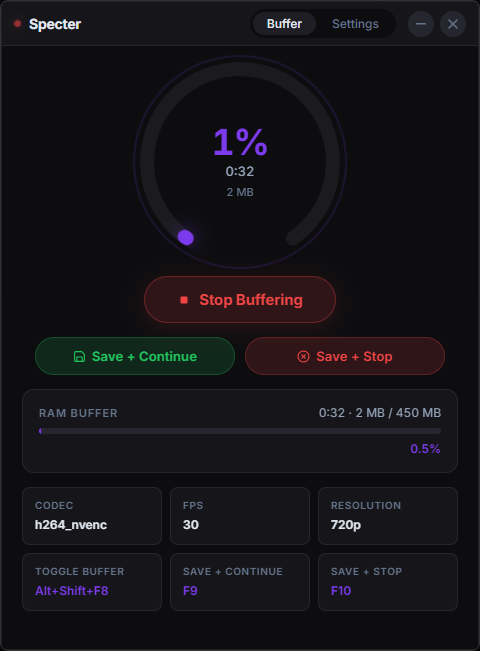
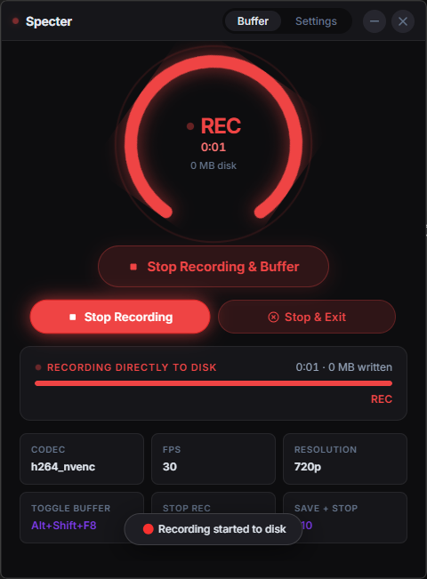
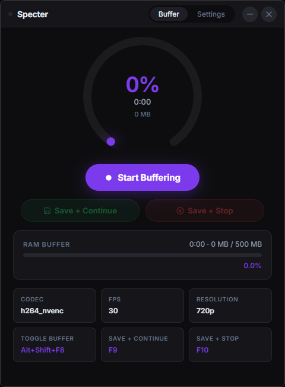
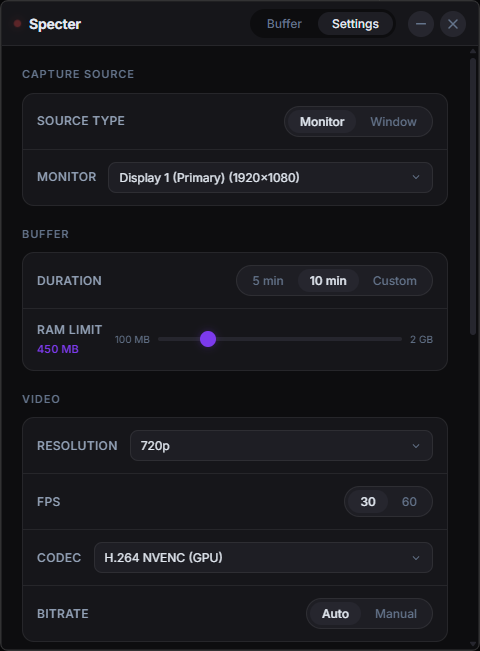

<div align="center">
  
  <h1>Specter</h1>
  <p><b>Replay buffer that lives in RAM, plus a standalone screen recorder.</b></p>

  <p>
    
    
    
  </p>
</div>

Specter is a desktop capture tool for Windows built on Rust and Tauri v2. It has two
independent parts that share the same capture and encoding pipeline:

* **Replay buffer** — FFmpeg streams fragmented MP4 into memory, a ring buffer keeps the
  last N minutes, and pressing the save hotkey writes that buffer to disk without
  re-encoding.
* **Record** — a separate tab that records video or audio-only straight to disk, with
  live source switching, microphone/system audio mixing and a real audio level meter.

FFmpeg is used as an external process; the application itself only manages the process,
the buffer and the UI.

## Screenshots

<div align="center">
  <table>
    <tr>
      <td align="center" width="50%">
        <b>RAM buffer active</b><br>
        
      </td>
      <td align="center" width="50%">
        <b>Recording to disk</b><br>
        
      </td>
    </tr>
    <tr>
      <td align="center" width="50%">
        <b>Idle</b><br>
        
      </td>
      <td align="center" width="50%">
        <b>Settings</b><br>
        
      </td>
    </tr>
  </table>
</div>

## Features

* **Buffer in RAM** — nothing is written to disk until you save. The ring buffer is
  bounded by both size (`ram_limit_mb`) and duration (`buffer_minutes`), and evicts
  whole fragments in FIFO order.
* **Hardware capture** — monitors are captured with Desktop Duplication (`ddagrab`);
  windows and FFmpeg builds without that filter fall back to GDI (`gdigrab`). The
  backend is a setting (`auto` / `dda` / `gdi`).
* **Hardware encoding** — NVENC (`h264_nvenc`, `hevc_nvenc`) is the default. The
  pipeline also accepts AMF and QuickSync encoder names in the config, and falls back to
  `libx264`/`libx265`. The encoder preset (`speed` / `balanced` / `quality`) is mapped per
  encoder family.
* **Save + continue** — the save hotkey flushes the buffered pre-roll and keeps
  recording to the same file instead of stopping.
* **Crash-safe segments** — every segment is written as Matroska and remuxed to MP4
  only on stop, so a crash or a failed source switch leaves playable footage.
* **Live switching** — monitor, window, audio route and microphone can be changed while
  recording; the new FFmpeg segment is started before the old one is stopped.
* **Constant-rate output** — segments use `-fps_mode cfr` with B-frames disabled, which
  keeps concatenation safe. Duplicated frames stay visible in FFmpeg's progress stream,
  and the UI warns when the capture path delivers too few real frames or when the
  encoder falls behind real time.
* **Preview on demand** — the Record tab loads a single JPEG frame when you press
  *Show preview*, never on page load.

## Hotkeys

Registered globally and configurable in the settings file.

| Action | Default | Behaviour |
|---|---|---|
| Toggle buffer | `Alt+Shift+F8` | Starts or stops the replay buffer. |
| Save + continue / Stop | `F9` | In buffer mode: writes the pre-roll and continues into a file. While recording: stops and saves. |
| Save + stop | `F10` | Finalizes the clip and stops the capture engine. |

## Configuration

Settings live in `%APPDATA%\specter\config.json` and are written when you change them in
the UI. The full reference is in [docs/SETTINGS.md](docs/SETTINGS.md); the most relevant
keys:

| Key | Default | Values |
|---|---|---|
| `buffer_minutes` | `5` | `1` – `60` |
| `ram_limit_mb` | `500` | `100` – `2000` |
| `resolution` | `"1080p"` | `native`, `720p`, `1080p`, `1440p` |
| `fps` | `60` | `30`, `60` |
| `codec` | `"h264_nvenc"` | Settings UI: `h264_nvenc`, `hevc_nvenc`, `libx264`. The config also accepts `h264_amf`, `hevc_amf`, `h264_qsv`, `hevc_qsv`, `libx265` |
| `bitrate_mbps` | `null` | `1` – `100`, or `null` to derive it from resolution, FPS and quality |
| `capture_backend` | `"auto"` | `auto`, `dda`, `gdi` |
| `video_preset` | `"balanced"` | `speed`, `balanced`, `quality` |
| `capture_source` | `"screen:0"` | `screen:N` or `window:PID` |
| `output_folder` | `<Videos>\Specter` | Destination directory, resolved from the user's Videos folder on first launch |
| `recording_mode` | `"video"` | `video`, `audio` |
| `recording_resolution` | `"1080p"` | `source`, `720p`, `1080p`, `1440p` |
| `recording_fps` | `60` | `30`, `48`, `60`, `120`, `144` |
| `recording_quality` | `"high"` | `low`, `medium`, `high`, `ultra` |
| `recording_audio` | `"none"` | `none`, `mic`, `system`, `both` |
| `recording_codec` | `"h264_nvenc"` | GPU/CPU toggle in the Record tab: `h264_nvenc`, `hevc_nvenc`, `libx264`, `libx265` |
| `mic_device` | `""` | DirectShow device name; empty selects the first detected microphone |

## Record tab

* **Modes** — video (MP4) or audio only (M4A). Audio-only requires an audio source.
* **Presets** — resolution, FPS and quality can be changed without leaving the page, and
  the choice is saved immediately.
* **Audio** — `none`, `mic`, `system` (loopback) or `both` (mixed with `amix`). System
  audio is captured over WASAPI, so it records exactly what the default playback device
  is playing; no Stereo Mix or virtual cable is required.
* **Meter** — while the tab is open a small FFmpeg process measures the selected
  microphone and the level bar responds before recording starts. It is stopped before
  the recorder opens the same device.
* **Warnings** — the header reports encoder saturation and capture starvation with
  separate messages, so a slow capture path is not mistaken for a slow encoder.

## Building and running

### Requirements

* Windows 10/11 x86_64.
* Rust (stable) with the MSVC toolchain.
* Visual Studio 2022 **Build Tools** with the *Desktop development with C++* workload and
  a Windows 10/11 SDK. The full IDE is not required.
* Node.js 18+ and npm.
* FFmpeg with `ddagrab` support for hardware desktop capture (a build with NVENC/QSV/AMF
  if you want hardware encoding).

`cargo`, `link.exe` and the Windows SDK headers must be visible in the shell you build
from. Either use the *x64 Native Tools Command Prompt for VS 2022* or set `PATH`, `LIB`
and `INCLUDE` manually.

### FFmpeg lookup order

Specter looks for `ffmpeg.exe` in this order and falls back to `ffmpeg` from `PATH`:

1. `<folder with specter.exe>\ffmpeg.exe`
2. `<folder with specter.exe>\bin\ffmpeg.exe`
3. `%LOCALAPPDATA%\Specter\bin\ffmpeg.exe`
4. `PATH`

The installed build uses the FFmpeg you provide; nothing is bundled.

### Development

```bash
npm install          # install frontend dependencies
npm run dev          # tauri dev: Vite dev server + Rust app with hot reload
npm run dev:web      # frontend only, opens in a browser (no IPC)
```

`npm run dev` compiles the Rust side and opens the app window. The first Rust build takes
a few minutes; later builds are incremental.

### Production build

```bash
npx tauri build                    # installer + portable binary for the host OS
npx tauri build --bundles nsis      # NSIS setup only
npx tauri build --no-bundle         # compile only, no installer
```

`beforeBuildCommand` in `src-tauri/tauri.conf.json` runs `npx vite build` automatically,
so the installer always contains the current frontend. Output:

* portable binary — `src-tauri/target/release/specter.exe`
* NSIS setup — `src-tauri/target/release/bundle/nsis/Specter_0.1.0_x64-setup.exe`

If the build fails with `Access is denied` while replacing `target/release/specter.exe`,
close the running application first. A silent install/upgrade can be done with
`Specter_0.1.0_x64-setup.exe /S`.

### Tests

```bash
cd src-tauri
cargo test --release
```

Two tests are ignored by default because they need a real desktop session and a
microphone (`ddagrab`/`gdigrab` frame capture and the audio meter). Run them explicitly:

```bash
cargo test --release -- --ignored
```

## Documentation

| Document | Contents |
|---|---|
| [Architecture](docs/ARCHITECTURE.md) | Component layout, Win32 bindings, IPC commands and threading |
| [Engine](docs/ENGINE.md) | Ring buffer, fMP4 fragment parsing, eviction rules |
| [Pipeline](docs/PIPELINE.md) | FFmpeg argument construction, encoder flags, capture backends |
| [Settings](docs/SETTINGS.md) | Configuration keys and `config.json` schema |
| [Third-party licenses](THIRD_PARTY_LICENSES.md) | Dependencies and FFmpeg licensing notes |

## License

MIT. See [LICENSE](LICENSE) and [THIRD_PARTY_LICENSES.md](THIRD_PARTY_LICENSES.md).
