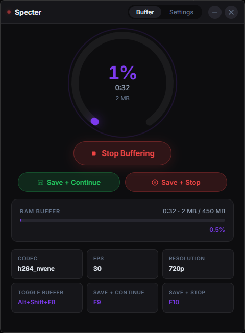
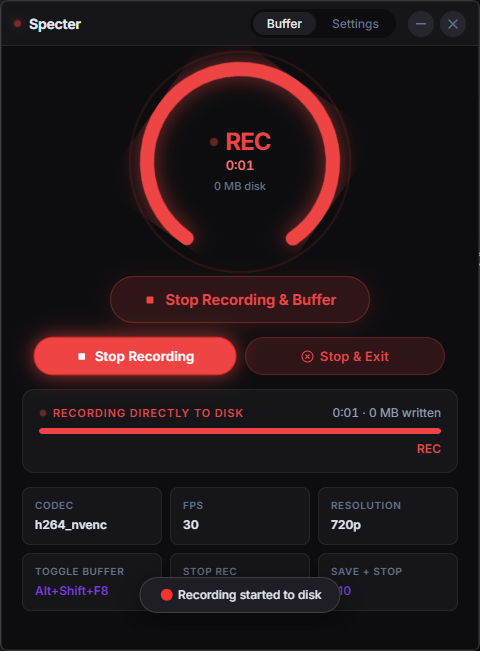
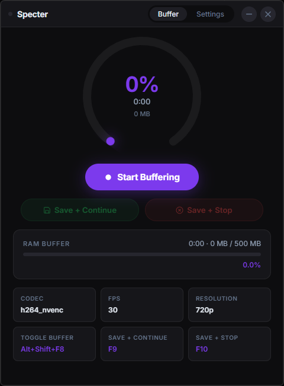
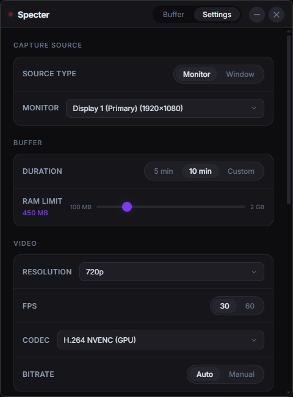
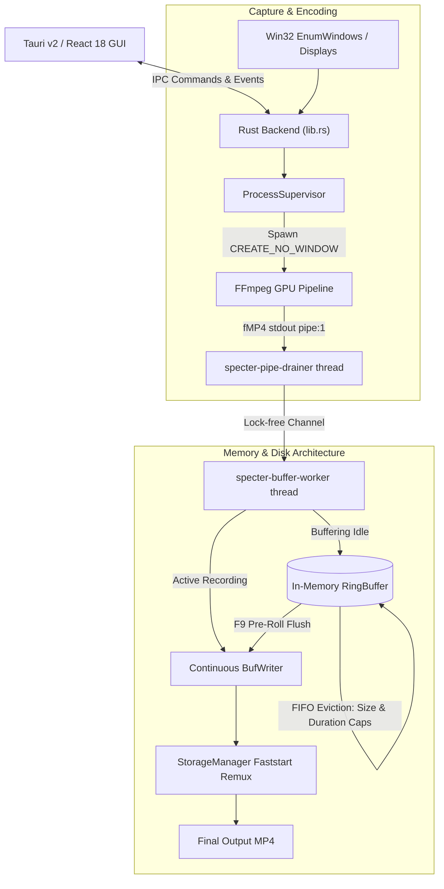

<div align="center">
  
  <h1>Specter</h1>
  <p><b>The Zero-Disk-Load Instant Replay Buffer & Screen Capture Engine.</b></p>
  <p><i>Zero-disk load. Pure RAM buffering. Instant clips with zero SSD wear.</i></p>

  <p>
    <a href="#the-specter-solution"></a>
    <a href="#the-specter-solution"></a>
    <a href="#highlights"></a>
    <a href="LICENSE"></a>
  </p>
</div>

> [!WARNING]
> **Personal Pet Project — Provided As-Is**
>
> Specter is a personal hobby and portfolio project, published strictly as-is.
> It is not a commercial product: there is **no official support, no guarantees, and no liability**.
> Use it entirely at your own risk. Always verify your capture parameters and ensure adequate disk space before initiating long recording sessions.

---

## Screenshots

<div align="center">
  <table>
    <tr>
      <td align="center" width="50%">
        <b>RAM Buffer Active (Standby Replay)</b><br>
        
      </td>
      <td align="center" width="50%">
        <b>Continuous Recording to Disk (REC)</b><br>
        
      </td>
    </tr>
    <tr>
      <td align="center" width="50%">
        <b>Standby / Idle Dashboard</b><br>
        
      </td>
      <td align="center" width="50%">
        <b>Flexible Settings & Configuration</b><br>
        
      </td>
    </tr>
  </table>
</div>

---

## The Problem with Traditional Replay Buffers

Gamers, streamers, and developers rely on instant replay tools to capture unexpected moments. However, traditional solutions (OBS Replay Buffer, NVIDIA ShadowPlay, AMD ReLive) have a major architectural drawback:

* **Continuous SSD Degradation:** At 1080p60 or 1440p60 high-bitrate settings, legacy buffers continuously write and rewrite rolling video chunks to disk. This silently burns **15 to 40 GB of flash write cycles every single day**, rapidly exhausting SSD endurance.
* **Bloated Background Suites:** Most capture apps are bundled with multi-gigabyte recording suites or Chromium processes that consume excessive system memory while idling.
* **Rigid Mode Isolation:** Replay buffer and continuous recording are typically split into two disconnected modes. If an epic gaming moment expands into a longer match, you cannot smoothly convert your replay buffer into a live recording without dropping frames.

---

## The Specter Solution

Specter is engineered from the ground up in **Rust** and **Tauri v2** to eliminate disk wear while maximizing game performance:

* **Zero-Disk In-Memory Ring Buffer:** Video fragments stream directly through an in-memory queue (`VecDeque<Chunk>`). The past $N$ minutes stay strictly in RAM. **Zero bytes touch your SSD** until you press save.
* **Hardware-Accelerated GPU Encoding:** Direct silicon integration with NVIDIA NVENC (`h264_nvenc`, `hevc_nvenc`), AMD AMF (`h264_amf`), Intel QuickSync (`h264_qsv`), and ultra-fast CPU fallback (`libx264`).
* **Instant Pre-Roll to Disk Transition:** Pressing **Save + Continue (F9)** instantly flushes the in-memory buffer to disk as pre-roll and seamlessly continues streaming incoming frames to the file in real time.
* **Faststart Remuxing (~50 ms):** Saved clips pass through a zero-re-encoding stream copy that fixes container durations and optimizes atom layout (`+faststart`) for instant seeking in any media player.
* **Decoupled Lock-Free Pipe Drainage:** A dedicated pipe drainer thread feeds incoming FFmpeg chunks into a synchronized channel buffer, preventing pipe saturation or encoder stalls during heavy 1440p/4K 144 FPS sessions.
* **Ultra-Low System Footprint:** Packaged as a clean ~3 MB installer with a single system tray icon and frameless neon glassmorphism UI.



---

## Highlights

| Area | What You Get |
|---|---|
| **Zero-Disk Engine** | Continuous screen buffering directly in RAM (`VecDeque<Chunk>`). Zero SSD write cycles during standby. |
| **GPU Acceleration** | Full NVENC, AMF, and QSV hardware encoding support for 60/120/144 FPS screen recording. |
| **Instant Pre-Roll** | Transitions from RAM buffer to live continuous disk recording with the press of a single hotkey (**F9**). |
| **Strict GOP Precision** | Locked 1-second keyframe intervals with disabled scenecut for uniform buffer chunk granularity. |
| **Accurate Timestamps** | 50ms fast stream-copy remux (`-movflags +faststart`) fixes container timestamps and enables immediate seeking. |
| **Window & Screen Capture** | Native Win32 window filtering (`EnumWindows`) or entire monitor capture (`EnumDisplayMonitors`). |
| **Global Shortcuts** | Background keyboard hooks for buffer toggling, instant clip saving, and continuous recording. |
| **Native System Tray** | Single system tray icon with left-click toggle and right-click context menu (Open, Buffer, Save, Quit). |
| **Subsystem Isolation** | Native Windows GUI subsystem compilation (`#![cfg_attr(windows, windows_subsystem = "windows")]`) — zero console popups. |
| **Ultra-Low Footprint** | Native Rust binary, ~3 MB installer, minimal memory footprint (100–500 MB RAM configurable). |

---

## Global Shortcuts & Hotkeys

All hotkeys are registered globally at the Windows OS level, operating seamlessly even when Specter is minimized or running behind fullscreen DirectX/Vulkan games:

| Action | Default Hotkey | Configurable | Behavior |
|---|---|---|---|
| **Toggle Buffer** | `Alt+Shift+F8` | Yes | Starts or stops the replay buffering engine. |
| **Save + Continue / Stop Rec** | `F9` | Yes | In buffer mode: flushes pre-roll and starts recording to disk. In recording mode: stops and saves clip. |
| **Save + Stop** | `F10` | Yes | Finalizes clip to disk and completely stops the capture engine. |

---

## Configuration Reference

Settings are stored persistently at `%APPDATA%\specter\config.json`. Key parameters:

| Parameter | Default | Range / Options | Description |
|---|---|---|---|
| `buffer_minutes` | `5` | `1` – `30` | Maximum length of in-memory replay buffer. |
| `ram_limit_mb` | `500` | `100` – `4000` | Hard cap on RAM allocated to the buffer. |
| `resolution` | `"1080p"` | `1080p`, `1440p`, `720p`, `source` | Target output resolution. |
| `fps` | `60` | `30`, `60`, `120`, `144` | Target framerate. |
| `codec` | `"h264_nvenc"` | `h264_nvenc`, `hevc_nvenc`, `h264_amf`, `h264_qsv`, `libx264` | Encoder backend. |
| `bitrate_mbps` | `null` | `1` – `50` (or `null` for auto) | Target bitrate in Mbps. |
| `output_folder` | `""` | Any valid directory | Default destination: `%USERPROFILE%\Videos\Specter`. |
| `capture_source` | `"screen:0"` | `screen:N` or `window:PID` | Display index or target process ID. |
| `capture_cursor` | `false` | `true`, `false` | Capture mouse pointer (false prevents cursor flicker). |
| `start_minimized` | `false` | `true`, `false` | Launch directly to system tray. |

---

## Building from Source

### Platform Support

* **Windows 10 / 11 (x86_64)**: Full native production support. Full hardware acceleration (NVENC, AMF, QSV), native Win32 window and display enumeration, frameless window dragging, and OS-level global hotkeys.
* **Linux (x86_64)**: Experimental / preview support. X11 desktop capture via FFmpeg (`-f x11grab`), software encoding (`libx264`), and `.AppImage` / `.deb` packaging.

### Prerequisites

* **Operating System**: Windows 10/11 (MSVC) or Linux (Ubuntu 22.04+ / Debian)
* **Rust Toolchain**: 1.77+ (`rustup install stable`)
* **Node.js**: 18+ and `npm`
* **FFmpeg**: Installed in system `PATH` (or placed in `bin/` or application directory)
* **Build Tools**: Visual Studio 2022 Build Tools (Windows) or `build-essential` / `pkg-config` / `libwebkit2gtk-4.1-dev` (Linux)

### Compilation

```bash
# 1. Clone repository
git clone https://github.com/Envel-Nikita-Gutsenkov/Specter.git
cd specter

# 2. Install dependencies
npm install

# 3. Build frontend bundle
npx vite build

# 4. Compile and run development mode
npm run dev
```

### Packaging Installers

To compile production standalone packages:

```bash
# Windows (NSIS & MSI)
npx tauri build --bundles nsis,msi

# Linux (AppImage & DEB)
npx tauri build --bundles appimage,deb
```

The generated packages will be located in:
* **Windows**: `src-tauri/target/release/bundle/nsis/Specter_0.1.0_x64-setup.exe` & `.msi`
* **Linux**: `src-tauri/target/release/bundle/appimage/Specter_0.1.0_amd64.AppImage` & `.deb`

---

## Deep-Dive Documentation

| Document | Description |
|---|---|
| [System Architecture](docs/ARCHITECTURE.md) | Component topology, Win32 bindings, IPC channels, and threading models |
| [Replay Engine](docs/ENGINE.md) | RingBuffer internals, fMP4 atom parsing, and dual-constraint memory algorithms |
| [Video Pipeline](docs/PIPELINE.md) | FFmpeg encoder profiles, NVENC/AMF/QSV flags, and low-latency tuning |
| [Settings Reference](docs/SETTINGS.md) | Complete configuration key reference and `config.json` schema |
| [Third-Party Licenses](THIRD_PARTY_LICENSES.md) | Legal compliance, FFmpeg subprocess isolation, and dependency attributions |

---

## License

**MIT License** — free to use, modify, distribute, and self-host. See [LICENSE](LICENSE) and [THIRD_PARTY_LICENSES.md](THIRD_PARTY_LICENSES.md) for complete details.
