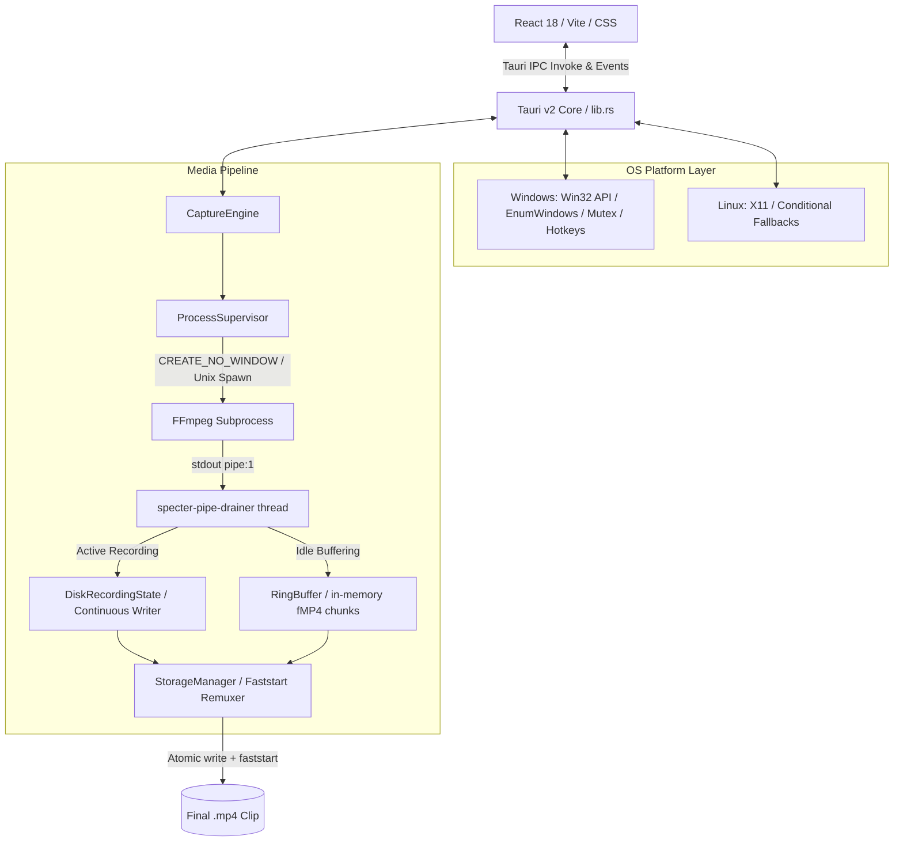

# Specter System Architecture

## Architecture Overview

Specter is engineered as a zero-disk-load instant replay daemon and desktop client for Windows 10/11 with experimental Linux support. The architecture separates the user presentation layer (React + TypeScript) from the high-performance media engine (Rust + FFmpeg), utilizing native OS platform abstractions (Win32 APIs on Windows, X11/Unix fallbacks on Linux).

---

## Subsystem Details

### 1. Tauri Core & IPC Layer (`src-tauri/src/lib.rs`)

* **Windowless Entry**: On Windows, compiled with `#![windows_subsystem = "windows"]` to prevent background console allocation.
* **Single-Instance Enforcement**: On Windows, uses a Win32 mutex `Local\dev.specter.single_instance.lock` to bring existing instances to the foreground and prevent duplicate FFmpeg capture hooks.
* **Platform Dragging**: On Windows, registers `app_start_drag` delegating to `ReleaseCapture()` and `SendMessageW(hwnd, WM_SYSCOMMAND, 0xF012, 0)` to guarantee drag response. Cross-platform fallback uses standard Tauri window dragging.

### 2. Capture Engine (`src-tauri/src/capture.rs`)

* Manages the lifecycle of the recording session.
* Uses dedicated OS threads (`specter-pipe-drainer`) with `std::thread::Builder` to guarantee non-blocking pipe reads.
* Thread synchronization: `Arc<Mutex<Option<RingBuffer>>>` and `Arc<Mutex<Option<DiskRecordingState>>>`.
* Window enumeration: Native `EnumWindows` on Windows; stubbed for Linux desktop environments.

### 3. Process Supervisor (`src-tauri/src/supervisor.rs`)

* Spawns FFmpeg as a detached child process with standard streams redirected.
* Configured with `CREATE_NO_WINDOW` (`0x08000000`) on Windows, and standard process creation on Linux.
* Input capture abstraction: Desktop Duplication (`ddagrab`) for monitors on Windows 10/11, with GDI (`gdigrab`) as the window/legacy fallback, and X11 display capture on Linux.
* Handles graceful termination (`child.kill()` + `child.wait()`) and pipe teardown on engine stop.

### 4. Storage Manager (`src-tauri/src/storage.rs`)

* Generates ISO 8601 timestamps without heavy runtime dependencies.
* Resolves output folders, falling back to `%USERPROFILE%\Videos\Specter` if left unset.
* Performs fast stream-copy remuxes with `-movflags +faststart` for zero-second playback latency.

### 5. Recorder Engine (`src-tauri/src/recorder.rs`)

* Independent from the replay buffer: the Record tab owns its own FFmpeg child process, so both can run side by side.
* Writes straight to a hidden `.Specter_<timestamp>_<n>.<ext>.tmp` segment in the output folder while recording. On stop the segments are concatenated and remuxed into `Specter_<timestamp>.mp4` (video) or `.m4a` (audio-only).
* Every video segment keeps an identical stream layout (one video + one AAC 48 kHz stereo track); video without a source gets a silent `anullsrc` track that is dropped at finalize. This keeps audio intact when segments recorded with different audio settings are concatenated.
* The capture source (monitor or window) can be switched mid-recording: a new FFmpeg process is started for the next segment before the previous one is stopped, so a failed switch never interrupts the active capture.
* Emits `recorder-level` (normalized 0..1 RMS) and `recorder-status` events for the live waveform and title bar indicator.
* Emits `recorder-warning` when FFmpeg's `-progress` stream shows the encoder falling behind real time, so a saturated GPU encoder never turns a recording into a silent slideshow.
* Audio graph: one source uses `-af astats/ametadata`; microphone + system use `-filter_complex amix` so both tracks share a single metered output.
* Device discovery parses `ffmpeg -list_devices true -f dshow` for microphone names only. System audio is not a capture device: FFmpeg has no Windows loopback source, so `src-tauri/src/loopback.rs` captures the default playback device over WASAPI and streams raw `s16le` 48 kHz stereo PCM into a named pipe that FFmpeg opens as its first input. Silence is written whenever the endpoint is idle so the audio stream never stalls the muxer.
