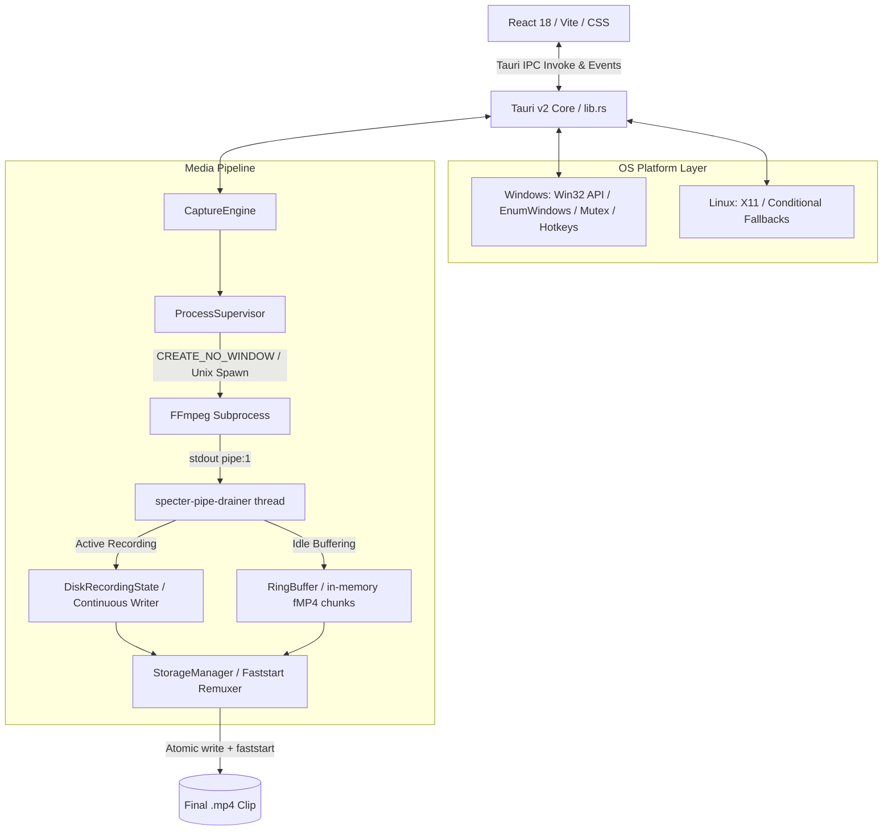

# Specter System Architecture

## Architecture Overview

Specter is engineered as a zero-disk-load instant replay daemon and desktop client for Windows 10/11 with experimental Linux support. The architecture separates the user presentation layer (React + TypeScript) from the high-performance media engine (Rust + FFmpeg), utilizing native OS platform abstractions (Win32 APIs on Windows, X11/Unix fallbacks on Linux).

---

## Subsystem Details

### 1. Tauri Core & IPC Layer (`src-tauri/src/lib.rs`)

* **Windowless Entry**: On Windows, compiled with `#![windows_subsystem = "windows"]` to prevent background console allocation.
* **Single-Instance Enforcement**: On Windows, uses a Win32 mutex `Global\SpecterSingleInstanceMutex` to bring existing instances to the foreground and prevent duplicate FFmpeg capture hooks.
* **Platform Dragging**: On Windows, registers `app_start_drag` delegating to `ReleaseCapture()` and `SendMessageW(hwnd, WM_SYSCOMMAND, 0xF012, 0)` to guarantee drag response. Cross-platform fallback uses standard Tauri window dragging.

### 2. Capture Engine (`src-tauri/src/capture.rs`)

* Manages the lifecycle of the recording session.
* Uses dedicated OS threads (`specter-pipe-drainer`) with `std::thread::Builder` to guarantee non-blocking pipe reads.
* Thread synchronization: `Arc<Mutex<Option<RingBuffer>>>` and `Arc<Mutex<Option<DiskRecordingState>>>`.
* Window enumeration: Native `EnumWindows` on Windows; stubbed for Linux desktop environments.

### 3. Process Supervisor (`src-tauri/src/supervisor.rs`)

* Spawns FFmpeg as a detached child process with standard streams redirected.
* Configured with `CREATE_NO_WINDOW` (`0x08000000`) on Windows, and standard process creation on Linux.
* Input capture abstraction: GDI/DDA desktop duplication on Windows (`-f gdigrab`), X11 display capture on Linux (`-f x11grab`).
* Handles graceful termination (`child.kill()` + `child.wait()`) and pipe teardown on engine stop.

### 4. Storage Manager (`src-tauri/src/storage.rs`)

* Generates ISO 8601 timestamps without heavy runtime dependencies.
* Resolves output folders, falling back to `%USERPROFILE%\Videos\Specter` if left unset.
* Performs fast stream-copy remuxes with `-movflags +faststart` for zero-second playback latency.
