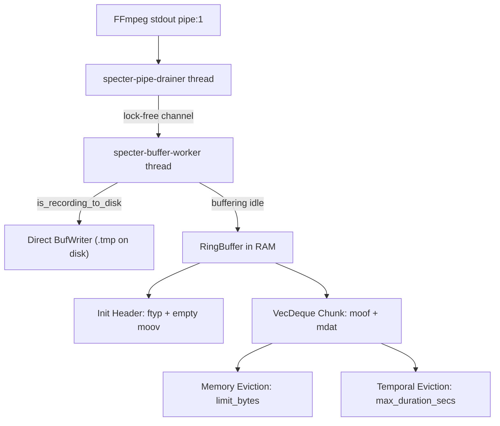
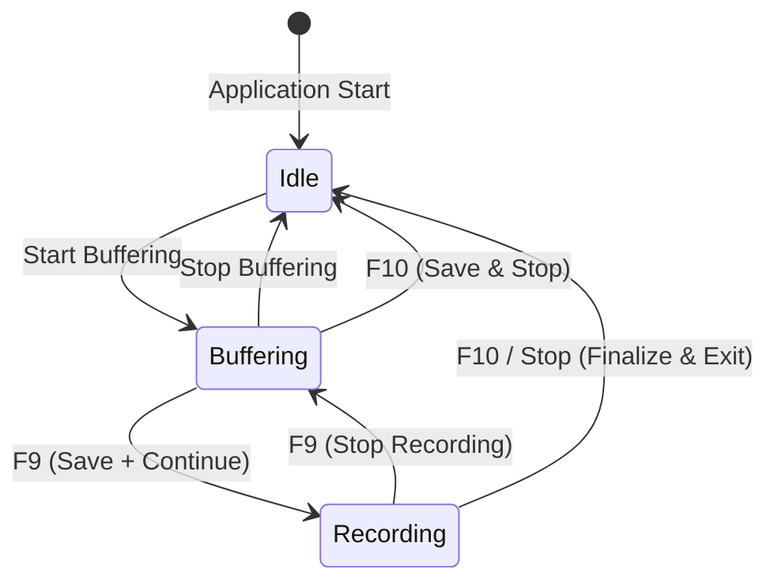

# Specter Replay Engine

## Abstract

Specter solves the fundamental drawback of traditional instant replay buffers: continuous flash memory wear. Modern high-bitrate screen recording (e.g., 60 FPS 1080p/1440p at 10–25 Mbps) writes approximately 4.5 to 11.25 GB of video data every hour. Over a month of regular gaming or workstation use, this generates several terabytes of redundant NAND flash write cycles, accelerating SSD degradation.

Specter implements a closed-circuit, in-memory ring buffer architecture in Rust that retains the past $N$ minutes of high-fidelity video entirely in RAM. Disk writes occur **strictly on demand** when the user requests an instant replay clip or initiates continuous disk recording.

---

## Ring Buffer Architecture

The replay core is centered around `RingBuffer` (in `src-tauri/src/ring_buffer.rs`).



### Fragmented MP4 (`fMP4`) Stream Ingestion

Standard MP4 files require a global `moov` index at the head or tail of the file that indexes every frame in the entire stream. If a stream is interrupted or read in progress, a standard MP4 is unreadable without remuxing.

Specter instructs FFmpeg to output a fragmented MP4 stream:

```bash
-f mp4 -movflags empty_moov+default_base_moof+frag_keyframe
```

This yields:
1. **Initialization Header (`ftyp` + `moov`)**: Emitted once upon FFmpeg initialization (~1 KB to 128 KB). It declares codec parameters, SPS/PPS sequence headers, and track structures. Specter captures and holds this header permanently in `RingBuffer.init_header`.
2. **Movie Fragments (`moof` + `mdat`)**: Every keyframe interval (GOP length, typically 1 second at `fps=60, -g 60`), FFmpeg flushes a discrete, self-contained fragment containing both frame indices (`moof`) and raw video payload (`mdat`).

### Dual-Constraint Eviction Algorithm

Chunks are pushed to a double-ended queue (`VecDeque<Chunk>`) with microsecond-precision timestamps. Eviction enforces two invariants simultaneously:

1. **Physical RAM Constraint**:
   $$\sum_{i=1}^{K} \text{len}(Chunk_i) + \text{len}(Header) \le \text{RAM Limit Bytes}$$
   When memory exceeds `limit_bytes`, oldest chunks are popped from the front:
   ```rust
   while self.total_bytes > self.limit_bytes && !self.chunks.is_empty() {
       if let Some(evicted) = self.chunks.pop_front() {
           self.total_bytes -= evicted.data.len();
       }
   }
   ```

2. **Temporal Window Constraint**:
   $$t_{\text{back}} - t_{\text{front}} \le T_{\text{max\_secs}}$$
   If elapsed duration exceeds `max_duration_secs`, expired chunks are purged:
   ```rust
   if self.max_duration_secs > 0.0 {
       while let Some(front) = self.chunks.front() {
           if (current_time - front.timestamp) > self.max_duration_secs && self.chunks.len() > 1 {
               if let Some(evicted) = self.chunks.pop_front() {
                   self.total_bytes -= evicted.data.len();
               }
           } else {
               break;
           }
       }
   }
   ```

---

## State Transition: Pre-Roll to Continuous Disk Recording

Specter provides a seamless bridge between instant replay and continuous recording:



When **Save + Continue** (or **F9**) is pressed:
1. `CaptureEngine::start_disk_recording()` acquires the `disk_recording` mutex.
2. An atomic temporary file (`.Specter_TIMESTAMP.mp4.tmp`) is opened with a buffered writer (`BufWriter<File>`).
3. The stored `init_header` and all existing in-memory chunks are flushed into the file, serving as instant pre-roll.
4. The memory queue `RingBuffer.chunks` is emptied to free system RAM.
5. The background `specter-reader` thread immediately routes live incoming FFmpeg chunks directly into `BufWriter<File>`.
6. Total duration begins counting up live: $T = T_{\text{initial}} + (t_{\text{now}} - t_{\text{start}})$.

When **Stop Recording** is pressed:
1. The `BufWriter` is flushed and closed.
2. Fast stream-copy remux is invoked (`ffmpeg -y -i temp.mp4 -c copy -movflags +faststart final.mp4`).
3. The temporary file is cleaned up.
4. `specter-reader` seamlessly resumes appending newly arriving chunks into the RAM `RingBuffer` with zero dropped frames.

---

## Container Timestamp Optimization (Faststart Remux)

Fragmented MP4s generated on-the-fly lack a final track duration in the container header, causing certain Windows Media Foundation players to report erratic durations (e.g. `26113:24`).

Specter eliminates this in ~50 milliseconds via native stream copy:

```bash
ffmpeg -y -i .Specter_2026-11-07.mp4.tmp -c copy -movflags +faststart Specter_2026-11-07.mp4
```

Because `-c copy` avoids video re-encoding, this step executes at disk I/O throughput (typically > 500 MB/s), producing clean, instantly shareable MP4 files with atom headers positioned at the front of the file (`+faststart`) for instant streaming playback.
