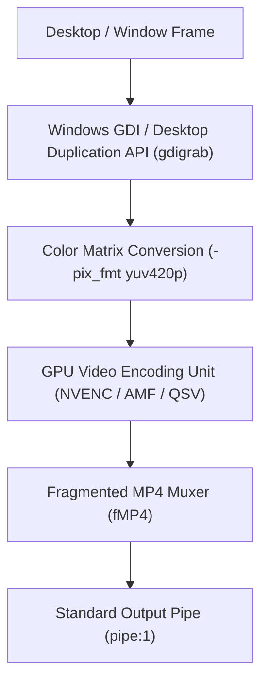

# Video Capture & Encoding Pipeline

## Pipeline Overview

Specter interfaces directly with FFmpeg through a managed subprocess supervised by `ProcessSupervisor`. Capture commands run silently in the background with `CREATE_NO_WINDOW` flags to ensure zero disruptive console popups.



---

## Hardware Encoder Profiles

### NVIDIA NVENC (`h264_nvenc` & `hevc_nvenc`)

Leverages dedicated silicon NVENC blocks on GeForce GTX/RTX hardware.

```bash
ffmpeg -f gdigrab -framerate 60 -i desktop \
  -vcodec h264_nvenc \
  -pix_fmt yuv420p \
  -preset p4 \
  -tune ll \
  -g 60 \
  -b:v 8M \
  -maxrate 12M \
  -bufsize 16M \
  -f mp4 \
  -movflags empty_moov+default_base_moof+frag_keyframe \
  pipe:1
```

* **Preset `p4`**: Low-latency performance profile balance.
* **Tune `ll`**: Low-latency tuning to prevent frame caching.
* **`-g <fps>`**: Forces GOP (Group of Pictures) length to exactly match FPS, ensuring clean 1-second keyframe boundaries for the fragmented MP4 container.
* **`-pix_fmt yuv420p`**: Enforces baseline 4:2:0 chroma subsampling for compatibility with all web browsers and media players.

### AMD AMF (`h264_amf` & `hevc_amf`)

Leverages AMD Video Core Next (VCN) hardware encoders on Radeon RX graphics cards.

```bash
ffmpeg -f gdigrab -framerate 60 -i desktop \
  -vcodec h264_amf \
  -pix_fmt yuv420p \
  -quality speed \
  -usage lowlatency \
  -g 60 \
  -b:v 8M \
  -f mp4 \
  -movflags empty_moov+default_base_moof+frag_keyframe \
  pipe:1
```

### Intel Quick Sync Video (`h264_qsv`)

Leverages Intel Iris / UHD / Arc graphics hardware encoders.

```bash
ffmpeg -f gdigrab -framerate 60 -i desktop \
  -vcodec h264_qsv \
  -pix_fmt yuv420p \
  -preset veryfast \
  -g 60 \
  -b:v 8M \
  -f mp4 \
  -movflags empty_moov+default_base_moof+frag_keyframe \
  pipe:1
```

### CPU Software Fallback (`libx264`)

Used when no discrete GPU hardware encoder is detected or configured.

```bash
ffmpeg -f gdigrab -framerate 30 -i desktop \
  -vcodec libx264 \
  -pix_fmt yuv420p \
  -preset ultrafast \
  -tune zerolatency \
  -g 30 \
  -crf 23 \
  -f mp4 \
  -movflags empty_moov+default_base_moof+frag_keyframe \
  pipe:1
```

---

## Source Selection

1. **Entire Monitor (`screen:N`)**:
   Enumerated through Win32 `EnumDisplayMonitors` + `GetMonitorInfoW`. Captures the desktop coordinate bounds `(left, top, width, height)` with `-offset_x` and `-offset_y`.
2. **Specific Application Window (`window:PID`)**:
   Enumerated through Win32 `EnumWindows` + `IsWindowVisible` + `GetWindowTextW`. The PID resolves to the matching window title, which is then passed to FFmpeg via `-i title="<window title>"`.

---

## Standalone Recorder (`src-tauri/src/recorder.rs`)

The Record tab does not reuse the ring buffer. It spawns a second FFmpeg process writing directly to disk, which keeps memory pressure flat during long sessions:

```text
```
Mic (dshow, input #0) ────────────────┐
System audio (WASAPI, pipe, input #1) ─┴─ amix ─ aresample=async ─ AAC ─┐
                                                            ├─ Matroska ── .tmp ── concat/remux ── .mp4
Screen (ddagrab / DDA) ─┐                                   │
                        ├─ hwdownload → yuv420p ── h264_nvenc ─┘
Window (gdigrab / GDI) ─┘
```

* **Crash-safe container**: segments are written as Matroska (`.mkv`/`.mka`), which is flushed frame by frame and never needs an end-of-file trailer. A stop at any moment, a failed source switch or a crash still leaves a playable file. On stop the segments are concatenated with the FFmpeg concat demuxer (`-c copy`) and remuxed to MP4 with `+faststart`; if the MP4 muxer rejects the stream layout, the Matroska result is kept instead of producing a broken MP4.
* **Hardware desktop capture**: monitors are captured with `ddagrab` (Desktop Duplication API) through `-f lavfi -i ddagrab=output_idx=N:framerate=F:draw_mouse=M`. DDA runs on the GPU and is not blocked by hardware accelerated windows (Chrome, Discord, games) the way GDI BitBlt via `gdigrab` is. `ddagrab` produces D3D11 hardware frames, so the filter chain starts with `hwdownload,format=bgra` and ends with `format=yuv420p` before scaling/encoding. Monitor selection uses `output_idx`, so no `offset_x`/`offset_y` is emitted for this path. Window capture (`window:X`) has no DDA equivalent and falls back to `gdigrab`; if the FFmpeg build lacks the `ddagrab` filter, monitors fall back to `gdigrab` as well (probed once per process).
* **Configurable trade-offs**: the capture backend and encoder preset are user settings (`capture_backend`, `video_preset`) shared by the replay buffer and the standalone recorder, so the same optimised path applies to both without hardcoding. `auto`/`dda` select Desktop Duplication, `gdi` forces the GDI fallback; `speed`/`balanced`/`quality` map to `p1`/`p4`/`p6` for NVENC and equivalent presets for AMF/QSV/libx264/libx265.
* **Known limitation (zero-copy)**: on the bundled FFmpeg build the D3D11 frames from `ddagrab` cannot be uploaded back to CUDA (`hwmap`/`scale_cuda` fail with `-40`) and `h264_nvenc` rejects a `cuda`/`d3d11` input, so frames are downloaded to system memory and encoded through NVENC's RapidMemory path. It is still fully GPU-captured and GPU-encoded, just with one PCIe copy per frame. Enabling true zero-copy would need a newer FFmpeg build.
* **Clean shutdown**: FFmpeg is stopped by writing `q` to its stdin so it finishes the container, with a 2-second grace period before a forced kill.
* **Uniform stream layout**: video segments always contain exactly one video stream and one AAC stereo 48 kHz stream. When no audio source is selected, a silent `anullsrc` track is muxed so every segment has the same layout; this is what lets the concat demuxer keep audio after switching the audio source or capture target mid-recording. The silent track is stripped (`-an`) at finalize time if no real audio source was ever used.
* **Bitrate presets**: `quality_bitrate_mbps()` scales a resolution base (4/7/14 Mbps for 720p/1080p/1440p) by `sqrt(fps / 60)` and a quality multiplier (0.6× low … 2.4× ultra).
* **Audio-only mode**: `-vn -ac 2 -ar 48000 -c:a aac`, output `.m4a`, at 160–320 kbps depending on quality.
* **Audio metering**: `astats=metadata=1:reset=1,ametadata=mode=print:key=lavfi.astats.Overall.RMS_level:direct=1` logs one RMS line per audio frame to stderr, which is mapped from dBFS (`-55..-10`) to `0..1` and emitted as `recorder-level` events at FFmpeg's frame rate. `direct=1` is essential: without it FFmpeg buffers the metadata and the waveform only updates after the process exits.
* **Early failure detection**: if FFmpeg exits within 300 ms of spawn (bad device name, unsupported encoder), the tail of `%TEMP%\specter_recorder_ffmpeg.log` is returned to the UI instead of leaving it in a fake recording state.
* **Encoder overload warning**: FFmpeg is launched with `-progress pipe:1 -nostats`; the recorder parses its `speed` value (`out_time / wall_time`) and emits `recorder-warning` when `speed < 0.85` for two consecutive reports, only after a two-second warm-up. The threshold is deliberately below 1.0: a realtime capture source alone reports about 0.93 because the last packet is flushed after the source stops, so a narrower limit would fire on healthy runs. Average `fps` is not used because it includes start-up time.
* **Live switching**: monitors, windows, audio sources and microphones can all be changed while recording. Each change starts a new FFmpeg process for a new segment first and only then stops the previous one, so the timer keeps running and a failed switch leaves the current capture untouched.
* **Input order is a correctness requirement**: every audio input is opened before the video input, and the video filter stays on `-vf` even when audio is mixed in a `-filter_complex` graph. FFmpeg's demux loop waits while an audio device has nothing queued, and `ddagrab` only ever exposes the newest desktop frame — every stall therefore discards frames that the CFR stage then silently replaces with duplicates. Measured on the reference machine (1080p60, `ddagrab` + microphone): video first → 388 duplicates per 480 frames; audio first → 7 duplicates per 1200 frames; mixing the video path into the complex graph reproduced the starvation (341 per 480), which is why only audio goes into the graph. Do not reorder the inputs back.
* **Audio first**: audio is captured through an independent input and processed with `aresample=async=1` before `amix`/metering, so dropped video frames never desynchronise or truncate the audio track. The microphone uses `dshow`; system audio cannot be read by FFmpeg at all on Windows, so it is captured over WASAPI in-process (`src-tauri/src/loopback.rs`) and piped as raw `s16le` 48 kHz stereo — the opposite of an opt-in Stereo Mix device, which most machines do not have. Audio bitrate keeps a high floor (160–320 kbps depending on the quality preset) because audio is cheap relative to video and degrades far more noticeably.
* **Standby audio meter**: the Record tab shows a live level before a recording exists. `start_audio_meter` spawns a tiny FFmpeg process (`dshow` microphone or the WASAPI loopback pipe → `astats`/`ametadata` → `-f null`) that emits `recorder-level`; `stop_audio_meter` releases it. The recorder stops it before opening the same device, so the two never fight over the microphone.
* **Preview**: `capture_preview` grabs one downscaled JPEG frame (`gdigrab`, or the configured backend as a fallback) for the Record tab. Nothing is captured until the user presses **Show preview**; the toggle is not persisted, so every launch starts with preview off. The Rust side has a hard 3-second timeout and the UI adds its own 8-second timeout plus explicit "no frame" handling, so a failed backend shows an error instead of an endless spinner. Polling is paused during recording so it never competes with the capture pipeline.
* **Playable concatenation**: screen segments are forced to a constant frame rate (`-fps_mode cfr -r <fps>`) and encoded without B-frames (`-bf 0`) in every encoder family. Desktop Duplication emits variable, update-driven timestamps; combined with B-frame reordering those timestamps made concatenated MP4s (and hardware decoders) misbehave. Final remux also uses `-fflags +genpts -avoid_negative_ts make_zero` so segment boundaries cannot leave out-of-order DTS. Because the output rate is constant, frames the capture path could not deliver are counted as `dup_frames` in FFmpeg's progress stream; the recorder uses that share to warn about capture starvation.
