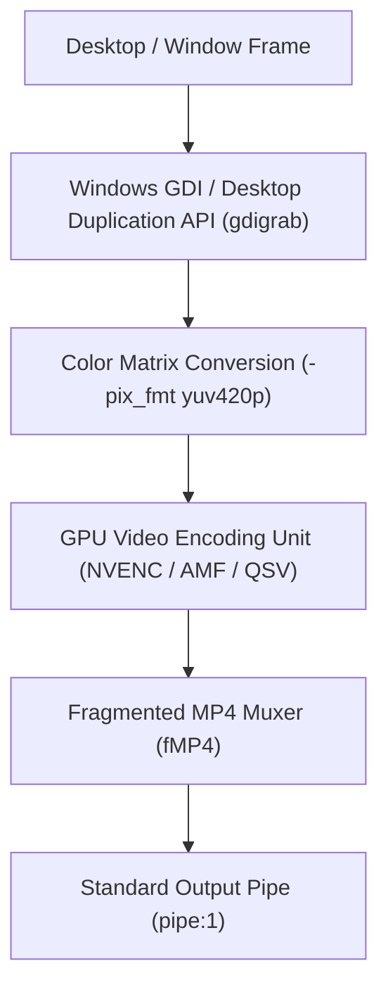

# Video Capture & Encoding Pipeline

## Pipeline Overview

Specter interfaces directly with FFmpeg through a managed subprocess supervised by `ProcessSupervisor`. Capture commands run silently in the background with `CREATE_NO_WINDOW` flags to ensure zero disruptive console popups.



---

## Hardware Encoder Profiles

### NVIDIA NVENC (`h264_nvenc` & `hevc_nvenc`)

Leverages dedicated silicon NVENC blocks on GeForce GTX/RTX hardware.

```bash
ffmpeg -f gdigrab -framerate 60 -i desktop \
  -vcodec h264_nvenc \
  -pix_fmt yuv420p \
  -preset p4 \
  -tune ll \
  -g 60 \
  -b:v 8M \
  -maxrate 12M \
  -bufsize 16M \
  -f mp4 \
  -movflags empty_moov+default_base_moof+frag_keyframe \
  pipe:1
```

* **Preset `p4`**: Low-latency performance profile balance.
* **Tune `ll`**: Low-latency tuning to prevent frame caching.
* **`-g <fps>`**: Forces GOP (Group of Pictures) length to exactly match FPS, ensuring clean 1-second keyframe boundaries for the fragmented MP4 container.
* **`-pix_fmt yuv420p`**: Enforces baseline 4:2:0 chroma subsampling for compatibility with all web browsers and media players.

### AMD AMF (`h264_amf` & `hevc_amf`)

Leverages AMD Video Core Next (VCN) hardware encoders on Radeon RX graphics cards.

```bash
ffmpeg -f gdigrab -framerate 60 -i desktop \
  -vcodec h264_amf \
  -pix_fmt yuv420p \
  -quality speed \
  -usage lowlatency \
  -g 60 \
  -b:v 8M \
  -f mp4 \
  -movflags empty_moov+default_base_moof+frag_keyframe \
  pipe:1
```

### Intel Quick Sync Video (`h264_qsv`)

Leverages Intel Iris / UHD / Arc graphics hardware encoders.

```bash
ffmpeg -f gdigrab -framerate 60 -i desktop \
  -vcodec h264_qsv \
  -pix_fmt yuv420p \
  -preset veryfast \
  -g 60 \
  -b:v 8M \
  -f mp4 \
  -movflags empty_moov+default_base_moof+frag_keyframe \
  pipe:1
```

### CPU Software Fallback (`libx264`)

Used when no discrete GPU hardware encoder is detected or configured.

```bash
ffmpeg -f gdigrab -framerate 30 -i desktop \
  -vcodec libx264 \
  -pix_fmt yuv420p \
  -preset ultrafast \
  -tune zerolatency \
  -g 30 \
  -crf 23 \
  -f mp4 \
  -movflags empty_moov+default_base_moof+frag_keyframe \
  pipe:1
```

---

## Source Selection

1. **Entire Monitor (`screen:N`)**:
   Enumerated through Win32 `EnumDisplayMonitors` + `GetMonitorInfoW`. Captures the desktop coordinate bounds `(left, top, width, height)` with `-offset_x` and `-offset_y`.
2. **Specific Application Window (`window:PID:TITLE`)**:
   Enumerated through Win32 `EnumWindows` + `IsWindowVisible` + `GetWindowTextW`. Captures window targets by window title via `-i title="<window title>"`.
